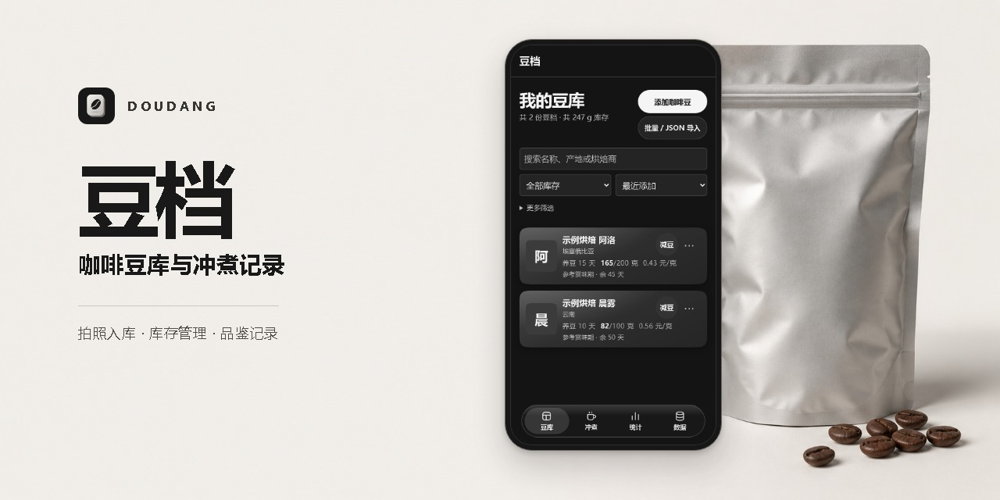

# 豆档

拍摄咖啡豆包装或从相册选图，照片默认交给 GLM 识别，结果自动填入豆档。核对后保存到本机豆库。GLM 不可用或没有读到字段时，改用浏览器内的 OCR。

在「批量 / JSON 导入」中可选最多 5 张照片，逐张查看识别状态、原文并重试。单图的多豆结果会分别列出，照片附给第一颗豆。可粘贴单个豆档或对象数组，核对必填字段后再入库。未提供余量时按净含量初始化。相机预览会在设备支持时显示缩放和闪光灯，系统相机可作为备用入口。

## 日常使用

- 点击豆库卡片查看完整资料、正反面照片、逐次品鉴和库存历史。在详情页编辑资料、续购、分享或开始冲煮。
- 减豆和品鉴用量会留下消耗记录。编辑、删除品鉴会按用量差额回算当前库存，库存校正单独记录。
- 赏味状态参考烘焙日期和自用记录中的起止天数。未填写时按烘焙后 7–60 天展示，可以调整，并可设置冷冻或在途状态。
- 冲煮页支持三段式、4:6 和自定义分段方案，计时可暂停、继续并在刷新后恢复。完成后保存品鉴时扣除用豆。
- 统计页显示已记录的消耗、花费、库存价值、库存预测和个人评分榜单。历史消费从记录功能启用后累计。
- 数据页可以导出、校验并合并恢复 JSON 备份，包含豆档、图片、库存历史、品鉴和已保存的冲煮方案。同编号但内容不同的数据另存为副本，重复导入相同内容会跳过。

点右上角「账号」即可注册、登录、修改密码或退出。登录后，豆档、照片、库存历史、品鉴和冲煮方案会自动保存到服务器。同账号的其他设备在页面打开、回到前台或每 15 秒检查更新。草稿和进行中的冲煮计时保留在当前设备。本机模式仍可独立使用，登录后可在账号面板选择「合并本机资料」。

## 本地预览

在本目录运行 `npm ci`、`npm run prepare:ocr`，然后运行 `python -m http.server 8765`，打开 `http://localhost:8765/`。这会在 `vendor/ocr/` 生成 OCR 脚本、识别引擎和中英语言包。

## 部署

使用静态站点服务，将本目录的 `index.html`、`preview.css`、`preview.mjs`、`workspace.mjs`、`importer.mjs`、`account.mjs`、`assets/app-icon.png`、`core/` 和生成的 `vendor/ocr/` 放到站点根目录。服务器需将 `.mjs` 作为 JavaScript 提供。目标地址为 `coffee.example.com`，需配置手机可访问的有效 HTTPS。

## 账号服务

在服务器安装生产依赖后运行 `node account-server.mjs`。设置 `CAFE_ACCOUNT_ORIGIN` 为站点的 HTTPS 来源，`CAFE_ACCOUNT_DB` 为站点目录之外的持久化 SQLite 文件路径，`CAFE_ACCOUNT_PORT` 默认是 1635。将同源的 `/api/account/` 转发到本机账号服务，并允许 16 MiB 请求体。如果本机代理负责覆盖 `X-Real-IP`，可设 `CAFE_ACCOUNT_TRUST_LOOPBACK_PROXY=1`。每个账号的数据上限为 16 MiB。备份服务器时使用 SQLite 的在线备份机制，以包含 WAL 中已提交的变更。

## iPhone 安装

在 iPhone 的 Safari 中下载[豆档描述文件](https://coffee.example.com/doudang.mobileconfig)，然后进入「设置 → 已下载描述文件」安装。

也可以运行 `node make-profile.mjs <实际 HTTPS 网址>` 生成 `doudang.mobileconfig`，默认内嵌豆档图标，也可在网址后附上自定义 PNG 图标路径。通过站点分发时，为描述文件设置 MIME 类型 `application/x-apple-aspen-config`。描述文件只包含可移除的全屏 Web Clip。

## GLM 识别

在识别服务目录放置 `package.json` 与 `package-lock.json`，运行 `npm ci --omit=dev` 安装依赖，再用 Node.js 20.20 或更新版本运行 `vision-server.mjs`。在服务端环境中配置：

- `CAFE_VISION_BASE_URL` 为兼容接口的 HTTPS Base URL，包含接口的版本路径。
- `CAFE_VISION_MODEL` 为可读取图片的模型名。
- `CAFE_VISION_API_KEY` 为供应商密钥。
- `CAFE_VISION_PORT` 默认为 1634，服务只监听本机。
- `CAFE_VISION_TRUST_LOOPBACK_PROXY` 默认为关闭。只有本机反向代理会覆盖客户端提供的 `X-Real-IP` 时才设为 `1`。Nginx 在识别路由内使用 `proxy_set_header X-Real-IP $remote_addr;`。

通过站点的 HTTPS 反向代理将 `/api/vision` 转给该进程，允许最多 2 MiB 的请求体。部署识别进程时将 `core/recognition.mjs` 放在 `vision-server.mjs` 的相对路径下。服务最多同时处理 5 张照片。每个来源 IP 每小时最多发起 20 次模型请求，整个进程最多 120 次。

## 致谢

感谢 Brew Guide 的作者 chuthree 和项目贡献者分享他们的实现。豆档在豆仓管理、冲煮与品鉴记录，以及拍照识别后核对入库的流程设计中参考了这个项目。 [Brew Guide](https://github.com/chuthree/brew-guide)
